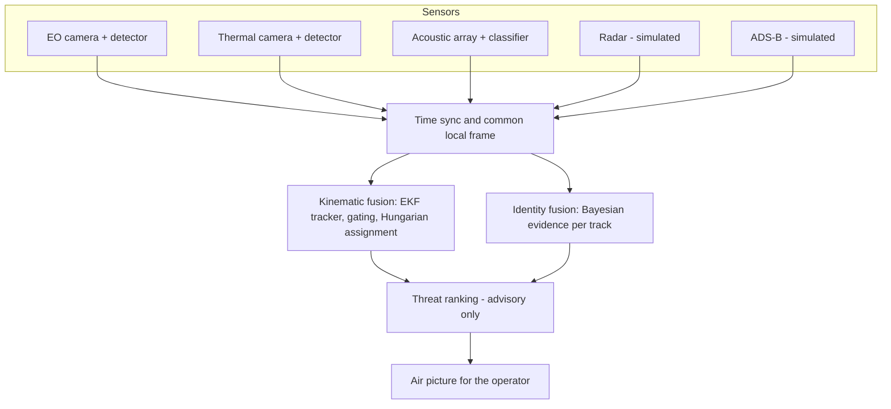

# Nabhnetra

*Nabhnetra* (नभनेत्र) is Sanskrit for "eye on the sky".

Open-source multi-sensor fusion for aerial situational awareness. Nabhnetra combines radar,
daylight (EO) and thermal (IR) cameras, an acoustic array and ADS-B into one tracked air
picture. Each track gets a class (drone, bird, aircraft or helicopter) with the evidence for it,
and an advisory threat level for a human operator.

A camera alone cannot measure range, and a radar alone cannot tell a bird from a drone.
Fused, they can do both. This repository measures how much each sensor adds.


Animated version: [docs/media/airpicture_mixed.gif](docs/media/airpicture_mixed.gif).

## What is real and what is simulated

| Part | Status | Source |
|---|---|---|
| EO and IR detectors | Trained on real video | Svanström multi-sensor drone dataset (drone, bird, airplane, helicopter) |
| Audio classifier | Trained on real audio | Same dataset (drone, helicopter, background) |
| Radar | Simulated | Radar range equation, Swerling-I detection, clutter, resolution cells |
| ADS-B | Simulated | Cooperative aircraft reporting position |
| Scenarios | Simulated | Inbound drones, bird flocks, swarm, night, fog, sensor failure |
| Tracker, identity fusion, threat ranking, metrics | Implemented here | numpy and scipy only |

The bridge between the two halves is the **confusion matrix**. Each trained model is measured
on held-out videos, and each simulated sensor samples its labels from that measured matrix. The
simulation therefore inherits real classifier behaviour, including the drone-versus-bird
confusion at long range.

> **Status (6 Nov 2026):** the EO, IR and acoustic confusion matrices are measured on held-out
> real data. Only the optional radar micro-Doppler matrix is still a placeholder, and it is off.

## Architecture



The modules map onto the JDL data-fusion levels:

| JDL level | Module |
|---|---|
| 0 Signal assessment | Per-sensor ML: detectors and classifiers (`scripts/train_*.py`) |
| 1 Object assessment | `tracker.py` (where is it) and `identity.py` (what is it) |
| 2 and 3 Situation and threat assessment | `threat.py` |
| 4 Process refinement | Roadmap: radar cueing a narrow-field camera |

The equations and every assumption are in [docs/DESIGN.md](docs/DESIGN.md).

## Quick start (simulation, CPU, offline)

```bash
pip install -r requirements.txt
python -m pytest -q
python scripts/run_demo.py --scenario mixed --gif
python scripts/run_ablation.py --seeds 5
```

- `run_demo.py` writes an air-picture PNG (and a GIF) plus a metrics summary to `results/demo/`.
- `run_ablation.py` runs every sensor combination on every scenario and writes
  `results/ablation/RESULTS.md` with tables and charts.

Scenarios: `mixed`, `night`, `fog`, `bird_flock`, `swarm`, `radar_failure`.

## Try the trained detectors

`samples/` holds eight 10-second clips the detectors never saw in training: one drone, bird,
airplane and helicopter for each camera.

```bash
python -I scripts/detect_video.py samples
python -I scripts/make_showcase.py
python -I scripts/detect_video.py --webcam 0
```

- The first command runs both detectors, scores each clip against its labels, and writes
  annotated videos and contact sheets to `results/detections/`.
- The second tiles all eight clips into one `showcase.mp4` and `showcase.gif`.
- The third runs the daylight detector live on your webcam; press q to quit. Point it at a
  drone video on your phone.


Daylight clips score 96–100% found with 99–100% the right class. Thermal is strong on the
drone and helicopter clips. On the distant airliner (a 4–5 pixel warm streak) it flips between
"aircraft" and "bird". That is the case fusion exists for: radar speed and ADS-B settle it at once.

## Real-data pipeline

1. **Get the dataset** (about 355 MB, CC BY 4.0) from
   [DroneDetectionThesis/Drone-detection-dataset](https://github.com/DroneDetectionThesis/Drone-detection-dataset).
2. **Install the training extras.**

   ```bash
   pip install -r requirements-ml.txt
   ```

   `mcos-decoder` reads the dataset's MATLAB label files. Version 0.1.0 is about 265 lines of
   pure Python with no network or file-writing code, and depends only on numpy and scipy (reviewed
   6 Nov 2026). Treat downloaded data as untrusted and run scripts that read it with `python -I`.

   For the GPU, install a CUDA build of torch (check pytorch.org for the current command):

   ```bash
   pip install torch torchvision --index-url https://download.pytorch.org/whl/cu128
   ```

3. **Convert videos and labels.** The split is by whole video.

   ```bash
   python scripts/prepare_svanstrom.py --data <dataset>/Data --modality IR
   python scripts/prepare_svanstrom.py --data <dataset>/Data --modality V
   ```

4. **Train the detectors.**

   ```bash
   python scripts/train_detector.py --data data/yolo_ir/dataset.yaml --name ir
   python scripts/train_detector.py --data data/yolo_v/dataset.yaml --name eo
   ```

5. **Measure them** and write the confusion matrices the simulator uses.

   ```bash
   python scripts/eval_confusion.py --weights runs/detect/ir/weights/best.pt --data data/yolo_ir --out configs/confusion/ir.json
   python scripts/eval_confusion.py --weights runs/detect/eo/weights/best.pt --data data/yolo_v --out configs/confusion/eo.json
   ```

   Copy the printed `px50`, `px_scale` and false-alarm rate into `configs/default.yaml`. The
   dataset was filmed at short range, so the script also tests each frame shrunk to 1/2 and 1/4
   to estimate how the detector behaves on smaller, more distant targets.
6. **Train the audio classifier** (5-fold cross-validation by file).

   ```bash
   python scripts/train_audio.py --audio <dataset>/Data/Audio
   ```

7. **Re-run the ablation.** These are the numbers you can quote.

## Results (6 Nov 2026)

### Classifiers on held-out real data

| Model | Test set | Precision | Recall | mAP50 | mAP50-95 |
|---|---|---|---|---|---|
| Thermal detector (YOLO11n) | 4,543 frames from 72 unseen videos | 0.833 | 0.819 | 0.825 | 0.435 |
| Daylight detector (YOLO11n) | 3,466 frames from 55 unseen videos | 0.856 | 0.825 | 0.850 | 0.406 |

The audio CNN, tested 5-fold by whole clip, recognises 93.5% of drone and 91.6% of helicopter
windows. However, 23% of background windows raise a false drone or helicopter label.

### Fusion (simulation driven by the measured classifiers)

Mixed traffic (3 inbound drones, 12 birds, an aircraft and a helicopter), 10 seeds:

| | Radar only | Radar + EO + IR | All sensors |
|---|---|---|---|
| Drones identified | 40% | 100% | 100% |
| Median time to identify a drone | 94 s | 13 s | 16 s |
| Class accuracy | 81% | 98% | 97% |
| Bird track-time labelled drone | 3.3% | 1.1% | 1.7% |
| Position error (RMSE) | 26.5 m | 21.7 m | 22.1 m |

- **Night:** radar plus the daylight camera identifies 53% of drones; radar plus thermal
  identifies 100%.
- **20-drone swarm:** class accuracy rises from 42% (radar only) to 94% (radar, EO and IR).
- **Microphone:** adding the microphone array does not help yet. Its measured false-alarm rate
  feeds wrong evidence into bird tracks; fixing that is on the roadmap.

All tables and charts: [docs/RESULTS.md](docs/RESULTS.md).


**What these numbers are and are not.**
- The classifier behaviour is measured on real data. The radar, ADS-B, scenarios and camera
  optics (pixel angle) are simulated assumptions.
- The dataset was filmed within about 200 m. Long-range behaviour comes from shrinking frames,
  which is an approximation.
- The daylight detection curve is measured on loose boxes, so it is conservative.
- Validate with real sensor recordings before relying on any of this.

## Design choices worth knowing

- **Direction-only reports cannot start or confirm a track while radar is active.** Without
  this rule, radar clutter plus a camera seeing a real target on a similar bearing creates
  ghost tracks. In the simulated `mixed` scenario this rule cut false tracks from about 360 per
  hour to about 5.
- **Classifier mistakes are correlated in time.** The simulated cameras repeat their last label
  with some probability, and identity fusion forgets old evidence and down-weights each sensor.
  Without both, the fusion becomes overconfident.
- **Threat ranking is advisory.** It orders tracks for a human to look at and triggers nothing.
- **Runs offline on a CPU.** No cloud services, no network calls, and a fused step takes about
  10 ms on a laptop (each step covers 0.5 s of sensor data).

## Roadmap

- Cut the audio false alarms (require 2 of 3 consecutive windows to agree), then re-measure
- Train the detectors longer with a lower learning rate (both runs stopped early, at epochs 23 and 25)
- Radar micro-Doppler classifier, for example trained on the DIAT-μSAT dataset (DIAT Pune)
- IMM filter (constant-velocity plus coordinated-turn) for manoeuvring drones
- JPDA association for dense swarms and flocks
- A second camera site, so cameras alone can triangulate range
- Radar cueing a narrow-field PTZ camera (JDL level 4 sensor management)
- ONNX export and edge deployment (Jetson-class hardware)
- Real sensor input through ROS 2

## Responsible use

Nabhnetra covers detection, tracking, identification and advisory alerting for human operators.
It contains no engagement or weapon-control logic. Scenarios use a local coordinate frame
around a generic defended point; no real location is modelled. All data is public.

## Credits

- Dataset: F. Svanström, F. Alonso-Fernandez, C. Englund, "A dataset for multi-sensor drone
  detection", *Data in Brief* 39 (2021), CC BY 4.0. Also "Real-time drone detection and tracking
  with visible, thermal and acoustic sensors", ICPR 2020.
- Label decoding: `mcos-decoder` (MIT).
- Detector training: Ultralytics YOLO (AGPL-3.0). The fusion code depends only on the confusion
  matrices, so the detector can be swapped for an Apache-2.0 model such as YOLOX or RT-DETR.

## License

MIT. See [LICENSE](LICENSE).
