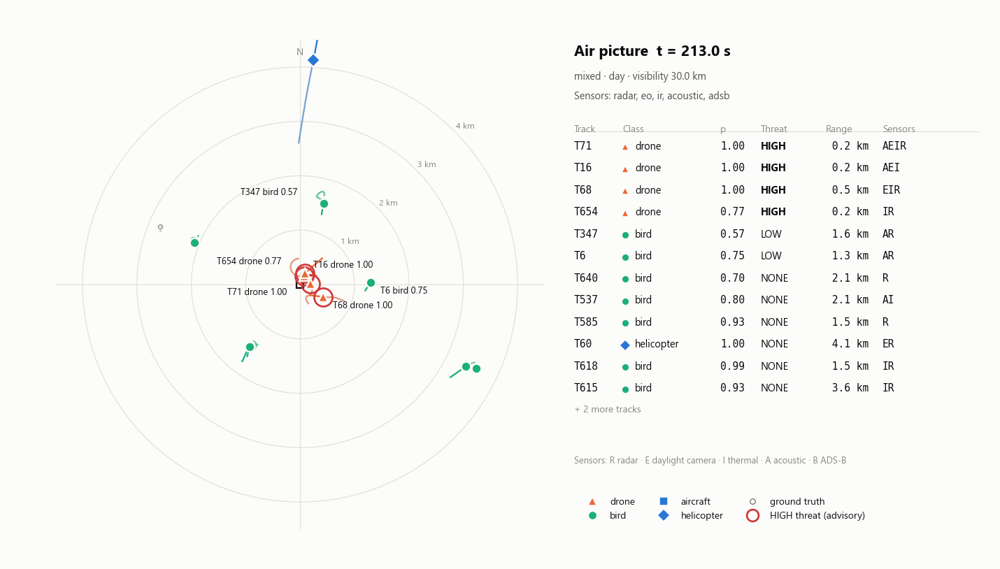
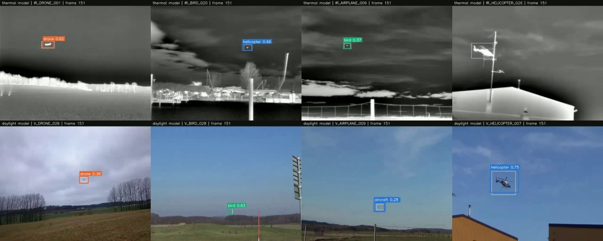
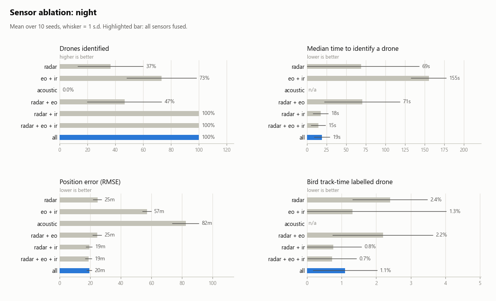
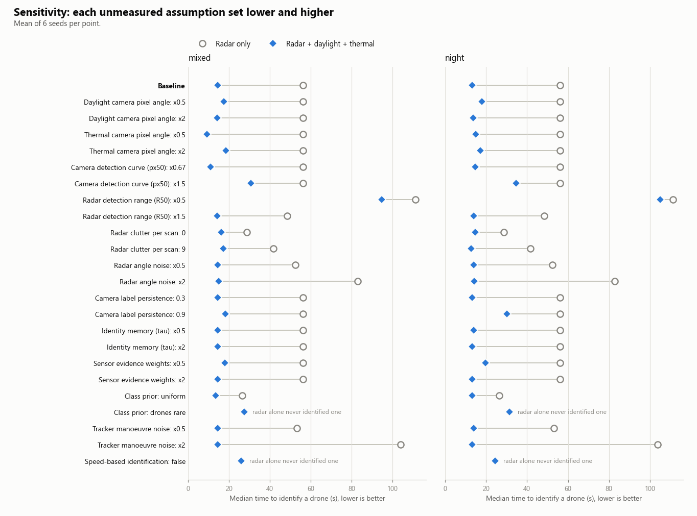

# Nabhnetra

*Nabhnetra* (नभनेत्र) is Sanskrit for "eye on the sky".

Open-source multi-sensor fusion for aerial situational awareness. Nabhnetra combines radar,
daylight (EO) and thermal (IR) cameras, an acoustic array and ADS-B into one tracked air
picture. Each track gets a class (drone, bird, aircraft or helicopter) with the evidence for it,
and an advisory threat level for a human operator.

A camera alone cannot measure range, and a radar alone cannot tell a bird from a drone.
Fused, they can do both. This repository measures how much each sensor adds, and checks that
the answer does not depend on the simulation's assumptions.



Animated version: [docs/media/airpicture_mixed.gif](docs/media/airpicture_mixed.gif).

## Results at a glance (6 Nov 2026)

- **Detectors on unseen videos:** thermal mAP50 0.825, daylight 0.850 (YOLO11n, split by whole video).
- **Fusion, mixed traffic, 10 seeds:** radar alone identifies 37% of inbound drones (median 69 s);
  radar plus both cameras identifies all of them in a median 13 s, with class accuracy 98%
  against 82% and a quarter less position error.
- **Robustness:** every unmeasured assumption was set lower and higher (23 settings, 2
  scenarios). Fusion beat radar alone in **48 of 48** settings.
- **Microphone:** raw false alarms on 31% of background seconds, cut to 4% with a confidence and
  voting rule. With the rule, the microphone lifts drone identification in fog from 93% to 97%.
- **Speed:** detectors at 33–125 frames per second on a laptop GPU; the fusion runs 6–31× faster
  than real time on one CPU core.

## What is real and what is simulated

| Part | Status | Source |
|---|---|---|
| EO and IR detectors | Trained and measured on real video | Svanström multi-sensor drone dataset (drone, bird, airplane, helicopter) |
| Audio classifier | Trained and measured on real audio | Same dataset (drone, helicopter, background) |
| Radar | Simulated | Radar range equation, Swerling-I detection, clutter, resolution cells |
| ADS-B | Simulated | Cooperative aircraft reporting position |
| Scenarios | Simulated | Inbound drones, bird flocks, swarm, night, fog, sensor failure |
| Tracker, identity fusion, threat ranking, metrics | Implemented here | numpy and scipy only |

The bridge between the two halves is the **confusion matrix**. Each trained model is measured
on held-out data, and each simulated sensor samples its labels from that measured matrix. The
simulation therefore inherits real classifier behaviour, including the drone-versus-bird
confusion at long range. Only the optional radar micro-Doppler matrix is a placeholder, and it
is switched off.

## Architecture


| JDL level | Module |
|---|---|
| 0 Signal assessment | Per-sensor ML: detectors and classifiers (`scripts/train_*.py`) |
| 1 Object assessment | `tracker.py` (where is it) and `identity.py` (what is it) |
| 2 and 3 Situation and threat assessment | `threat.py` |
| 4 Process refinement | Roadmap: radar cueing a narrow-field camera |

The equations and every assumption are in [docs/DESIGN.md](docs/DESIGN.md).

## Quick start (simulation, CPU, offline)

```bash
pip install -r requirements.txt
python -m pytest -q
python -I scripts/run_demo.py --scenario mixed --gif
python -I scripts/run_ablation.py --seeds 10
python -I scripts/run_sensitivity.py
```

- `run_demo.py` writes an air-picture PNG and GIF plus a metrics summary to `results/demo/`.
- `run_ablation.py` runs every sensor combination on every scenario and writes tables and charts.
- `run_sensitivity.py` changes each unmeasured assumption and checks whether fusion still wins.
- Any setting can be changed for one run, e.g. `--set tracker.model=cv sensors.radar.r50_m=1500`.

Scenarios: `mixed`, `night`, `fog`, `bird_flock`, `swarm`, `radar_failure`.

## Try the trained detectors

`samples/` holds eight 10-second clips the detectors never saw in training: one drone, bird,
airplane and helicopter for each camera.

```bash
python -I scripts/detect_video.py samples
python -I scripts/make_showcase.py
python -I scripts/detect_video.py --webcam 0
python -I scripts/fuse_recording.py my_phone_clip.mp4
```

- `detect_video.py samples` runs both detectors, scores each clip against its labels, and writes
  annotated videos and contact sheets to `results/detections/`.
- `make_showcase.py` tiles all eight clips into one video and GIF.
- `--webcam 0` runs the daylight detector live; press q to quit.
- `fuse_recording.py` fuses the daylight detector and the audio classifier on any video with
  sound, such as a phone recording of a drone, using the same identity fusion as the simulator.



Daylight clips score 96–100% found with 99–100% the right class. Thermal is strong on the drone
and helicopter clips. On a distant airliner (a 4–5 pixel warm streak) it flips between
"aircraft" and "bird": the case fusion exists for, since radar speed and ADS-B settle it at once.

## Real-data pipeline

1. **Get the dataset** (about 355 MB, CC BY 4.0) from
   [DroneDetectionThesis/Drone-detection-dataset](https://github.com/DroneDetectionThesis/Drone-detection-dataset).
2. **Install the training extras.**

   ```bash
   pip install -r requirements-ml.txt
   ```

   For the GPU, install a CUDA build of torch (check pytorch.org for the current command):

   ```bash
   pip install torch torchvision --index-url https://download.pytorch.org/whl/cu128
   ```

   `mcos-decoder` reads the dataset's MATLAB label files. Version 0.1.0 is about 265 lines of
   pure Python with no network or file-writing code (reviewed 6 Nov 2026). Treat downloaded
   data as untrusted and run scripts that read it with `python -I`.
3. **Audit the labels.** All 650 label files decode, but 18 videos have label counts that do not
   match their frame counts (frames with two boxes are skipped by the decoder). The conversion
   step excludes them.

   ```bash
   python -I scripts/check_labels.py --data <dataset>/Data
   ```

4. **Convert videos and labels.** The split is by whole video.

   ```bash
   python -I scripts/prepare_svanstrom.py --data <dataset>/Data --modality IR
   python -I scripts/prepare_svanstrom.py --data <dataset>/Data --modality V
   ```

5. **Train the detectors.**

   ```bash
   python -I scripts/train_detector.py --data data/yolo_ir/dataset.yaml --name ir
   python -I scripts/train_detector.py --data data/yolo_v/dataset.yaml --name eo
   ```

6. **Measure them** and write the confusion matrices the simulator uses. The dataset was filmed
   at short range, so each frame is also tested shrunk to 1/2 and 1/4 to estimate how the
   detector behaves on smaller, more distant targets. Copy the printed `px50` and `px_scale`
   into `configs/default.yaml`.

   ```bash
   python -I scripts/eval_confusion.py --weights runs/detect/ir/weights/best.pt --data data/yolo_ir --out configs/confusion/ir.json
   python -I scripts/eval_confusion.py --weights runs/detect/eo/weights/best.pt --data data/yolo_v --out configs/confusion/eo.json
   python -I scripts/eval_by_distance.py --model ir
   python -I scripts/eval_by_distance.py --model eo
   ```

7. **Train the audio classifier** (5-fold cross-validation by file; also picks the false-alarm rule).

   ```bash
   python -I scripts/train_audio.py --audio <dataset>/Data/Audio --save-model models/audio_cnn.pt
   ```

8. **Re-run the ablation and the sensitivity analysis.**

## Results (6 Nov 2026)

### Classifiers on held-out real data

| Model | Test set | Precision | Recall | mAP50 | mAP50-95 |
|---|---|---|---|---|---|
| Thermal detector (YOLO11n) | 4,543 frames from 72 unseen videos | 0.833 | 0.819 | 0.825 | 0.435 |
| Daylight detector (YOLO11n) | 3,466 frames from 55 unseen videos | 0.856 | 0.825 | 0.850 | 0.406 |

Within the dataset's own distance tags, detection holds at 93–98% from close to distant. Tested
at four times the filmed distance (frames shrunk to a quarter), it falls to 10–13%.

| Audio rule (5-fold by whole clip) | Drone recall | Helicopter recall | Background false alarms |
|---|---|---|---|
| Raw classifier | 96% | 93% | 31% |
| Confidence ≥ 0.9 in each of the last 3 seconds | 80% | 70% | 4% |

### Fusion (simulation driven by the measured classifiers)

Mixed traffic (3 inbound drones, 12 birds, an aircraft and a helicopter), IMM tracker, 10 seeds:

| | Radar only | Radar + EO + IR | All sensors |
|---|---|---|---|
| Drones identified | 37% | 100% | 100% |
| Median time to identify a drone | 69 s | 13 s | 15 s |
| Class accuracy | 82% | 98% | 97% |
| Bird track-time labelled drone | 2.4% | 0.5% | 0.9% |
| Position error (RMSE) | 24.8 m | 18.8 m | 18.4 m |

- **Night:** radar plus the daylight camera identifies 47% of drones; radar plus thermal, 100%.
- **Fog:** radar plus both cameras identifies 93%; adding the microphone, 97%.
- **20-drone swarm:** class accuracy rises from 42% (radar only) to 94%.
- **Radar failure (80–160 s):** the full system keeps tracking with no false tracks.
- **Tracker:** the IMM lowers position error against a single filter in every scenario: by
  13–18% in mixed, night and bird-flock traffic, 8% under radar failure, and 2% in the swarm.



### Sensitivity

Each unmeasured assumption (camera optics, detection curves, radar range, clutter, radar noise,
label persistence, fusion memory and weights, class prior, tracker noise, speed-based
identification) was set lower and higher. Fusion identified at least as many drones, sooner,
with at least the same accuracy in all 48 settings.



Full tables: [docs/RESULTS.md](docs/RESULTS.md), [docs/SENSITIVITY.md](docs/SENSITIVITY.md),
[docs/BENCHMARK.md](docs/BENCHMARK.md).

**What these numbers are and are not.**
- Classifier behaviour is measured on real data. The radar, ADS-B, scenarios and camera optics
  are simulated assumptions, and the sensitivity analysis shows the conclusions survive changing them.
- The dataset was filmed within about 200 m. Long-range behaviour comes from shrinking frames,
  which ignores haze and blur.
- The audio rule was chosen on the same cross-validated predictions it is reported on.
- Validate with real sensor recordings before relying on any of this.

## Design choices worth knowing

- **Direction-only reports cannot start or confirm a track while radar is active.** Without
  this rule, radar clutter plus a camera seeing a real target on a similar bearing creates
  ghost tracks: about 360 false tracks per hour in testing, down to about 5 with the rule.
- **IMM gating accepts a report if any model accepts it.** Gating on the blended estimate
  rejected the first off-course reports of a turn, so the filter never learned the target was
  manoeuvring.
- **Classifier mistakes are correlated in time.** Simulated cameras repeat their last label
  with some probability, and identity fusion fades old evidence and down-weights each sensor.
- **Threat ranking is advisory.** It orders tracks for a human to look at and triggers nothing.
- **Offline.** No cloud services or network calls at run time.

## Roadmap

- Field validation with real, synchronised sensors and local (Indian) footage of drones and birds
- Radar micro-Doppler classifier, for example trained on the DIAT-μSAT dataset (DIAT Pune)
- A coordinated-turn model in the IMM, and JPDA association for dense swarms and flocks
- A second camera site, so cameras alone can triangulate range
- Radar cueing a narrow-field PTZ camera (JDL level 4 sensor management)
- Optimised CPU inference (ONNX Runtime, OpenVINO) and Jetson-class edge deployment
- Real sensor input through ROS 2

## Responsible use

Nabhnetra covers detection, tracking, identification and advisory alerting for human operators.
It contains no engagement or weapon-control logic. Scenarios use a local coordinate frame
around a generic defended point; no real location is modelled. All data is public.

## Credits

- Dataset: F. Svanström, F. Alonso-Fernandez, C. Englund, "A dataset for multi-sensor drone
  detection", *Data in Brief* 39 (2021), CC BY 4.0. Also "Real-time drone detection and tracking
  with visible, thermal and acoustic sensors", ICPR 2020.
- Label decoding: `mcos-decoder` (MIT).
- Detector training: Ultralytics YOLO (AGPL-3.0). The fusion code depends only on the confusion
  matrices, so the detector can be swapped for an Apache-2.0 model such as YOLOX or RT-DETR.

## License

MIT. See [LICENSE](LICENSE).
