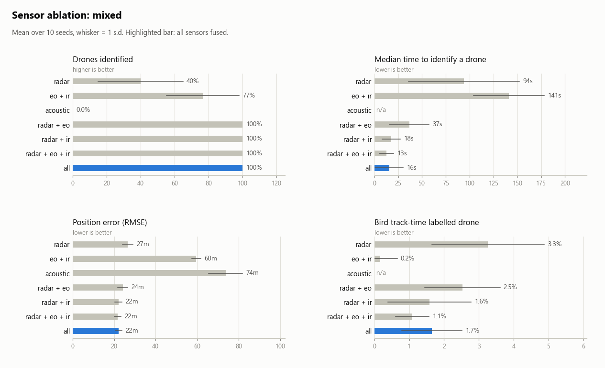
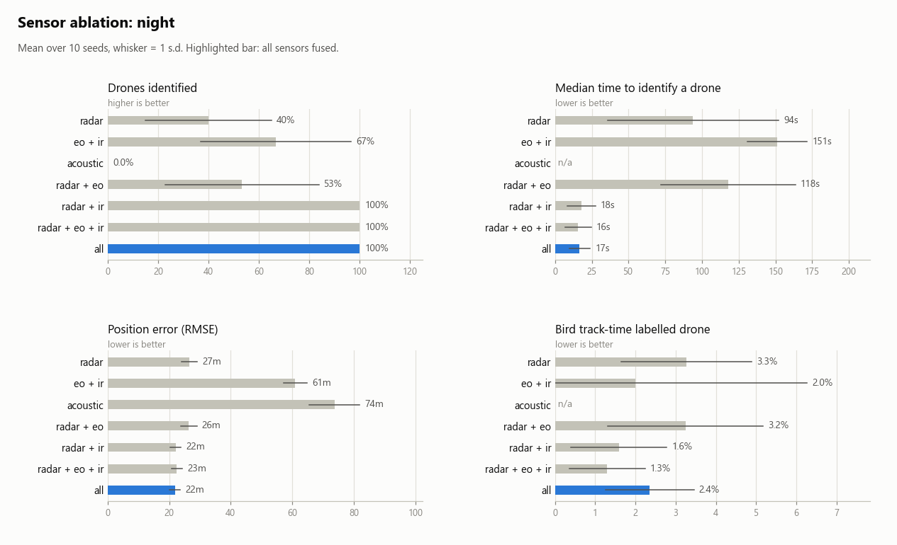
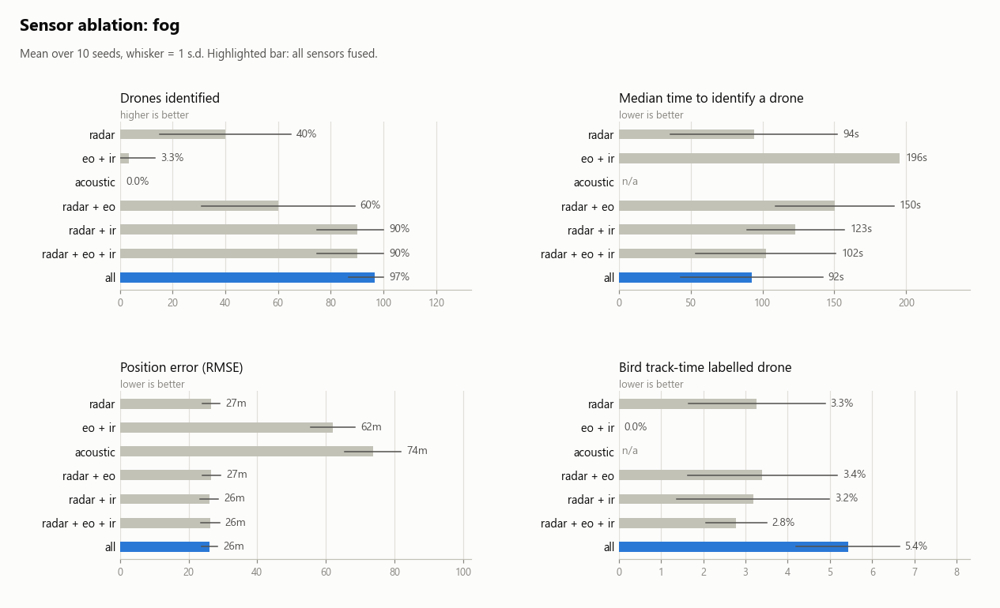
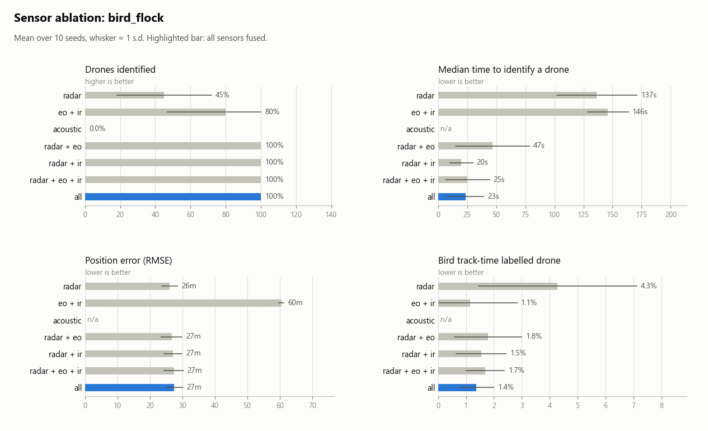
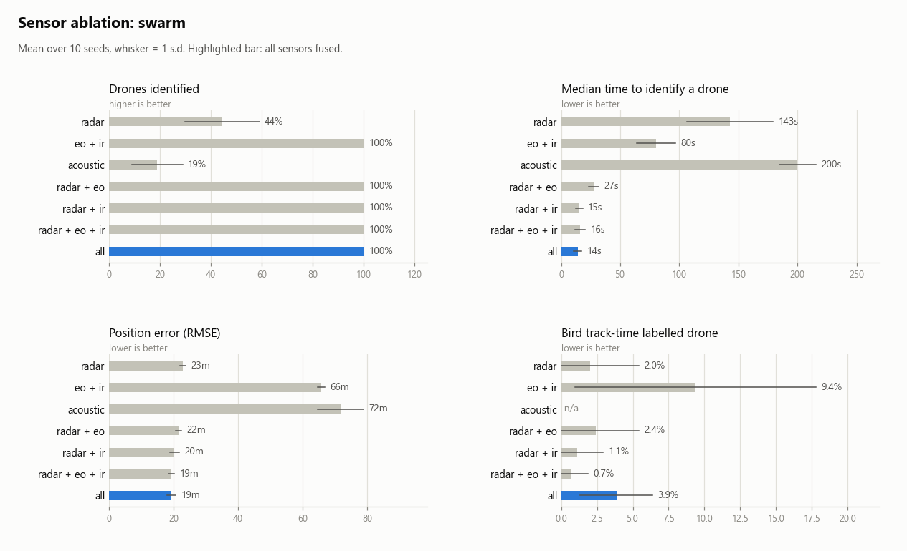
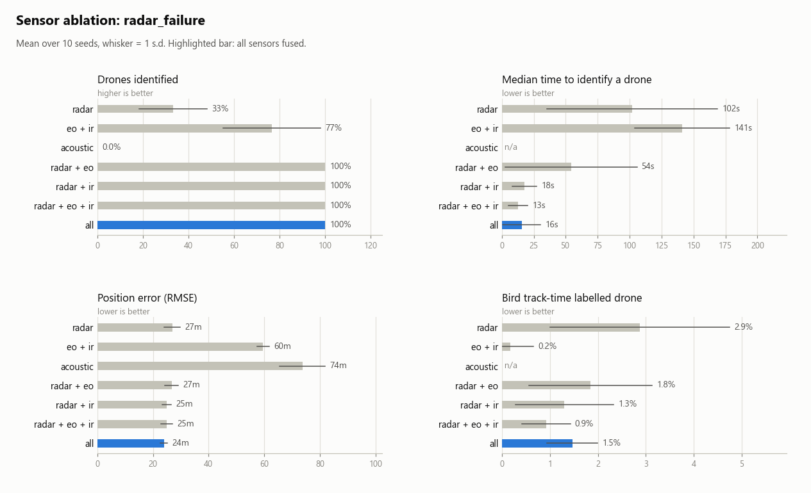

# Sensor ablation results (2026-11-06)

10 seeds per cell. Mean ± standard deviation. Metric definitions are in docs/DESIGN.md.

## mixed

_3 inbound drones, 12 birds (two flocks), 1 aircraft, 1 helicopter; clear day_

| Sensors | Drones identified % | Time to ID drone (s) | Track coverage % | Position RMSE (m) | False tracks / h | Class accuracy % | Bird as drone % | GOSPA (m) |
|---|---:|---:|---:|---:|---:|---:|---:|---:|
| radar | 40 ± 25 | 94 ± 58 | 68 ± 6 | 26.5 ± 2.6 | 2 ± 4 | 81 ± 4 | 3.3 ± 1.6 | 189 ± 12 |
| eo + ir | 77 ± 21 | 141 ± 37 | 4 ± 1 | 59.6 ± 2.2 | 1548 ± 850 | 91 ± 3 | 0.2 ± 0.5 | 342 ± 13 |
| acoustic | 0 ± 0 | n/a | 0 ± 0 | 73.7 ± 8.2 | 98 ± 46 | 100 ± 0 | n/a | 287 ± 2 |
| radar + eo | 100 ± 0 | 37 ± 21 | 68 ± 6 | 24.2 ± 2.4 | 3 ± 6 | 90 ± 4 | 2.5 ± 1.1 | 185 ± 12 |
| radar + ir | 100 ± 0 | 18 ± 10 | 69 ± 7 | 22.1 ± 1.8 | 8 ± 12 | 96 ± 2 | 1.6 ± 1.2 | 181 ± 13 |
| radar + eo + ir | 100 ± 0 | 13 ± 8 | 69 ± 7 | 21.7 ± 1.6 | 4 ± 10 | 98 ± 1 | 1.1 ± 0.5 | 182 ± 14 |
| all | 100 ± 0 | 16 ± 15 | 70 ± 6 | 22.1 ± 1.6 | 2 ± 4 | 97 ± 3 | 1.7 ± 0.9 | 186 ± 11 |

## night

_same traffic as mixed, at night (daylight camera nearly blind)_

| Sensors | Drones identified % | Time to ID drone (s) | Track coverage % | Position RMSE (m) | False tracks / h | Class accuracy % | Bird as drone % | GOSPA (m) |
|---|---:|---:|---:|---:|---:|---:|---:|---:|
| radar | 40 ± 25 | 94 ± 58 | 68 ± 6 | 26.5 ± 2.6 | 2 ± 4 | 81 ± 4 | 3.3 ± 1.6 | 189 ± 12 |
| eo + ir | 67 ± 30 | 151 ± 20 | 4 ± 1 | 60.9 ± 3.8 | 1202 ± 502 | 94 ± 4 | 2.0 ± 4.3 | 327 ± 9 |
| acoustic | 0 ± 0 | n/a | 0 ± 0 | 73.7 ± 8.2 | 98 ± 46 | 100 ± 0 | n/a | 287 ± 2 |
| radar + eo | 53 ± 31 | 118 ± 46 | 68 ± 7 | 26.4 ± 2.6 | 3 ± 6 | 82 ± 4 | 3.2 ± 1.9 | 188 ± 13 |
| radar + ir | 100 ± 0 | 18 ± 10 | 69 ± 7 | 22.1 ± 1.8 | 8 ± 12 | 96 ± 2 | 1.6 ± 1.2 | 181 ± 13 |
| radar + eo + ir | 100 ± 0 | 16 ± 9 | 70 ± 7 | 22.5 ± 1.7 | 3 ± 6 | 96 ± 2 | 1.3 ± 0.9 | 182 ± 12 |
| all | 100 ± 0 | 17 ± 7 | 69 ± 6 | 21.9 ± 1.8 | 4 ± 7 | 95 ± 2 | 2.4 ± 1.1 | 185 ± 12 |

## fog

_same traffic as mixed, 800 m visibility_

| Sensors | Drones identified % | Time to ID drone (s) | Track coverage % | Position RMSE (m) | False tracks / h | Class accuracy % | Bird as drone % | GOSPA (m) |
|---|---:|---:|---:|---:|---:|---:|---:|---:|
| radar | 40 ± 25 | 94 ± 58 | 68 ± 6 | 26.5 ± 2.6 | 2 ± 4 | 81 ± 4 | 3.3 ± 1.6 | 189 ± 12 |
| eo + ir | 3 ± 10 | 196 ± 0 | 0 ± 0 | 62.0 ± 6.5 | 537 ± 670 | 100 ± 0 | 0.0 ± 0.0 | 293 ± 12 |
| acoustic | 0 ± 0 | n/a | 0 ± 0 | 73.7 ± 8.2 | 98 ± 46 | 100 ± 0 | n/a | 287 ± 2 |
| radar + eo | 60 ± 29 | 150 ± 41 | 68 ± 6 | 26.7 ± 2.7 | 2 ± 4 | 82 ± 4 | 3.4 ± 1.8 | 189 ± 12 |
| radar + ir | 90 ± 15 | 123 ± 34 | 67 ± 6 | 26.0 ± 2.6 | 3 ± 6 | 84 ± 4 | 3.2 ± 1.8 | 189 ± 12 |
| radar + eo + ir | 90 ± 15 | 102 ± 49 | 68 ± 6 | 26.3 ± 2.7 | 6 ± 7 | 85 ± 4 | 2.8 ± 0.7 | 188 ± 13 |
| all | 97 ± 10 | 92 ± 50 | 68 ± 6 | 26.1 ± 2.4 | 0 ± 0 | 84 ± 3 | 5.4 ± 1.2 | 191 ± 13 |

## bird_flock

_2 drones approaching through 4 bird flocks (22 birds) on their paths_

| Sensors | Drones identified % | Time to ID drone (s) | Track coverage % | Position RMSE (m) | False tracks / h | Class accuracy % | Bird as drone % | GOSPA (m) |
|---|---:|---:|---:|---:|---:|---:|---:|---:|
| radar | 45 ± 27 | 137 ± 35 | 45 ± 4 | 26.0 ± 2.4 | 2 ± 4 | 85 ± 6 | 4.3 ± 2.8 | 272 ± 6 |
| eo + ir | 80 ± 33 | 146 ± 17 | 5 ± 1 | 60.4 ± 0.8 | 2002 ± 401 | 89 ± 4 | 1.1 ± 1.7 | 412 ± 5 |
| acoustic | 0 ± 0 | n/a | 0 ± 0 | n/a | 54 ± 39 | n/a | n/a | 346 ± 1 |
| radar + eo | 100 ± 0 | 47 ± 32 | 46 ± 3 | 26.7 ± 3.2 | 2 ± 4 | 93 ± 3 | 1.8 ± 1.2 | 272 ± 7 |
| radar + ir | 100 ± 0 | 20 ± 10 | 46 ± 4 | 27.1 ± 2.8 | 2 ± 4 | 95 ± 2 | 1.5 ± 0.9 | 275 ± 7 |
| radar + eo + ir | 100 ± 0 | 25 ± 19 | 46 ± 4 | 27.3 ± 3.0 | 6 ± 10 | 96 ± 2 | 1.7 ± 0.7 | 279 ± 7 |
| all | 100 ± 0 | 23 ± 16 | 46 ± 4 | 27.5 ± 2.7 | 0 ± 0 | 97 ± 1 | 1.4 ± 0.6 | 278 ± 7 |

## swarm

_20 drones from one 30-degree sector plus 4 birds_

| Sensors | Drones identified % | Time to ID drone (s) | Track coverage % | Position RMSE (m) | False tracks / h | Class accuracy % | Bird as drone % | GOSPA (m) |
|---|---:|---:|---:|---:|---:|---:|---:|---:|
| radar | 44 ± 15 | 143 ± 36 | 90 ± 2 | 22.9 ± 0.8 | 3 ± 6 | 42 ± 7 | 2.0 ± 3.4 | 144 ± 6 |
| eo + ir | 100 ± 0 | 80 ± 16 | 7 ± 1 | 65.7 ± 1.2 | 3321 ± 511 | 89 ± 4 | 9.4 ± 8.4 | 421 ± 5 |
| acoustic | 19 ± 10 | 200 ± 16 | 0 ± 0 | 71.7 ± 7.1 | 380 ± 92 | 100 ± 0 | n/a | 352 ± 4 |
| radar + eo | 100 ± 0 | 27 ± 4 | 90 ± 2 | 21.6 ± 0.9 | 8 ± 8 | 78 ± 4 | 2.4 ± 3.0 | 140 ± 6 |
| radar + ir | 100 ± 0 | 15 ± 3 | 91 ± 2 | 20.3 ± 1.4 | 4 ± 7 | 91 ± 2 | 1.1 ± 1.8 | 136 ± 12 |
| radar + eo + ir | 100 ± 0 | 16 ± 4 | 91 ± 2 | 19.3 ± 1.0 | 2 ± 4 | 94 ± 1 | 0.7 ± 1.2 | 135 ± 9 |
| all | 100 ± 0 | 14 ± 3 | 90 ± 2 | 19.3 ± 1.4 | 14 ± 10 | 95 ± 1 | 3.9 ± 2.5 | 138 ± 9 |

## radar_failure

_same traffic as mixed; radar is down from 80 s to 160 s_

| Sensors | Drones identified % | Time to ID drone (s) | Track coverage % | Position RMSE (m) | False tracks / h | Class accuracy % | Bird as drone % | GOSPA (m) |
|---|---:|---:|---:|---:|---:|---:|---:|---:|
| radar | 33 ± 15 | 102 ± 67 | 42 ± 4 | 26.9 ± 2.9 | 20 ± 12 | 82 ± 4 | 2.9 ± 1.9 | 224 ± 9 |
| eo + ir | 77 ± 21 | 141 ± 37 | 4 ± 1 | 59.6 ± 2.2 | 1548 ± 850 | 91 ± 3 | 0.2 ± 0.5 | 342 ± 13 |
| acoustic | 0 ± 0 | n/a | 0 ± 0 | 73.7 ± 8.2 | 98 ± 46 | 100 ± 0 | n/a | 287 ± 2 |
| radar + eo | 100 ± 0 | 54 ± 52 | 45 ± 4 | 26.7 ± 2.4 | 8 ± 10 | 91 ± 3 | 1.8 ± 1.3 | 229 ± 9 |
| radar + ir | 100 ± 0 | 18 ± 10 | 46 ± 6 | 25.0 ± 1.7 | 22 ± 12 | 95 ± 1 | 1.3 ± 1.0 | 222 ± 12 |
| radar + eo + ir | 100 ± 0 | 13 ± 8 | 46 ± 5 | 25.0 ± 2.1 | 9 ± 18 | 97 ± 1 | 0.9 ± 0.5 | 228 ± 9 |
| all | 100 ± 0 | 16 ± 15 | 48 ± 4 | 23.9 ± 1.3 | 4 ± 7 | 97 ± 1 | 1.5 ± 0.5 | 226 ± 6 |

