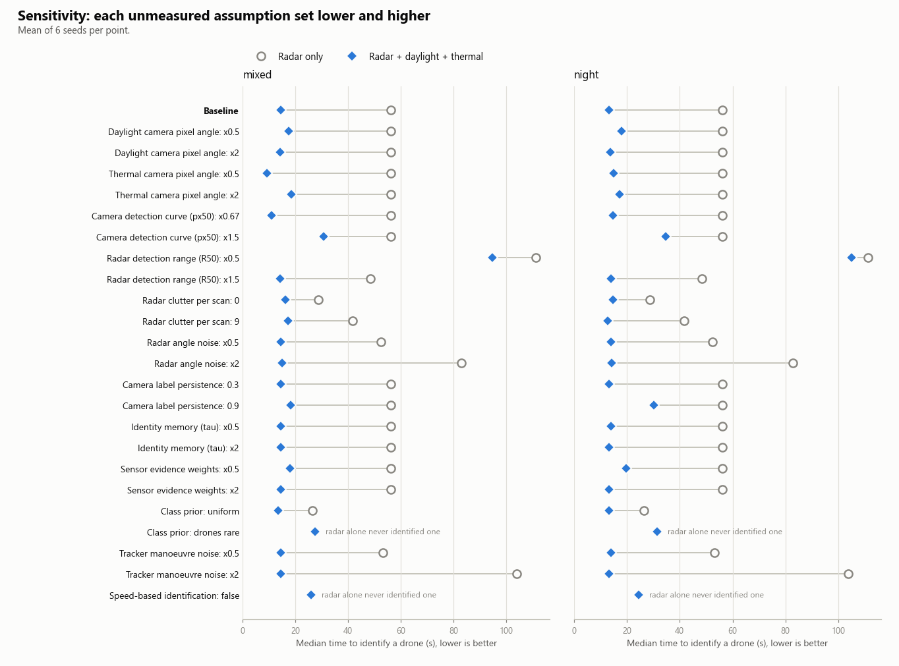

# Sensitivity analysis (2026-11-06)

Each unmeasured assumption is set lower and higher, one at a time. Cells show radar only → radar + EO + IR, mean of 6 seeds. A row passes when fusion identifies at least as many drones, identifies them sooner, and has at least the same class accuracy as radar alone.

**Fusion was better in 48 of 48 settings.**

## mixed

| Assumption | Setting | Drones identified | Time to identify a drone | Class accuracy | Bird time labelled drone | Position error | Fusion better? |
|---|---|---:|---:|---:|---:|---:|:---:|
| Baseline | baseline | 39% → 100% | 56s → 14s | 82% → 98% | 3% → 0% | 24m → 18m | yes |
| Daylight camera pixel angle | x0.5 | 39% → 100% | 56s → 17s | 82% → 98% | 3% → 1% | 24m → 18m | yes |
| Daylight camera pixel angle | x2 | 39% → 100% | 56s → 14s | 82% → 97% | 3% → 1% | 24m → 18m | yes |
| Thermal camera pixel angle | x0.5 | 39% → 100% | 56s → 9s | 82% → 98% | 3% → 1% | 24m → 17m | yes |
| Thermal camera pixel angle | x2 | 39% → 100% | 56s → 18s | 82% → 97% | 3% → 0% | 24m → 18m | yes |
| Camera detection curve (px50) | x0.67 | 39% → 100% | 56s → 11s | 82% → 99% | 3% → 0% | 24m → 15m | yes |
| Camera detection curve (px50) | x1.5 | 39% → 100% | 56s → 31s | 82% → 91% | 3% → 1% | 24m → 21m | yes |
| Radar detection range (R50) | x0.5 | 33% → 100% | 111s → 95s | 82% → 98% | 3% → 0% | 22m → 17m | yes |
| Radar detection range (R50) | x1.5 | 33% → 100% | 48s → 14s | 83% → 98% | 3% → 1% | 23m → 17m | yes |
| Radar clutter per scan | 0 | 28% → 100% | 29s → 16s | 82% → 98% | 2% → 1% | 24m → 18m | yes |
| Radar clutter per scan | 9 | 33% → 100% | 42s → 17s | 82% → 96% | 3% → 1% | 24m → 17m | yes |
| Radar angle noise | x0.5 | 39% → 100% | 52s → 14s | 82% → 98% | 3% → 0% | 16m → 15m | yes |
| Radar angle noise | x2 | 39% → 100% | 83s → 15s | 83% → 98% | 2% → 0% | 36m → 23m | yes |
| Camera label persistence | 0.3 | 39% → 100% | 56s → 14s | 82% → 98% | 3% → 0% | 24m → 18m | yes |
| Camera label persistence | 0.9 | 39% → 100% | 56s → 18s | 82% → 97% | 3% → 1% | 24m → 17m | yes |
| Identity memory (tau) | x0.5 | 39% → 100% | 56s → 14s | 82% → 95% | 3% → 1% | 24m → 18m | yes |
| Identity memory (tau) | x2 | 39% → 100% | 56s → 14s | 82% → 98% | 3% → 0% | 24m → 18m | yes |
| Sensor evidence weights | x0.5 | 39% → 100% | 56s → 18s | 82% → 96% | 3% → 0% | 24m → 18m | yes |
| Sensor evidence weights | x2 | 39% → 100% | 56s → 14s | 82% → 98% | 3% → 0% | 24m → 18m | yes |
| Class prior | uniform | 50% → 100% | 26s → 13s | 73% → 97% | 31% → 3% | 24m → 18m | yes |
| Class prior | drones rare | 0% → 100% | n/a → 27s | 76% → 94% | 0% → 0% | 24m → 18m | yes |
| Tracker manoeuvre noise | x0.5 | 39% → 100% | 53s → 14s | 82% → 98% | 4% → 1% | 24m → 19m | yes |
| Tracker manoeuvre noise | x2 | 39% → 100% | 104s → 14s | 82% → 98% | 2% → 0% | 24m → 18m | yes |
| Speed-based identification | false | 0% → 100% | n/a → 26s | 67% → 98% | 0% → 0% | 24m → 18m | yes |

## night

| Assumption | Setting | Drones identified | Time to identify a drone | Class accuracy | Bird time labelled drone | Position error | Fusion better? |
|---|---|---:|---:|---:|---:|---:|:---:|
| Baseline | baseline | 39% → 100% | 56s → 13s | 82% → 96% | 3% → 1% | 24m → 18m | yes |
| Daylight camera pixel angle | x0.5 | 39% → 100% | 56s → 18s | 82% → 95% | 3% → 1% | 24m → 19m | yes |
| Daylight camera pixel angle | x2 | 39% → 100% | 56s → 14s | 82% → 95% | 3% → 1% | 24m → 18m | yes |
| Thermal camera pixel angle | x0.5 | 39% → 100% | 56s → 15s | 82% → 98% | 3% → 0% | 24m → 17m | yes |
| Thermal camera pixel angle | x2 | 39% → 100% | 56s → 17s | 82% → 96% | 3% → 1% | 24m → 20m | yes |
| Camera detection curve (px50) | x0.67 | 39% → 100% | 56s → 15s | 82% → 98% | 3% → 1% | 24m → 16m | yes |
| Camera detection curve (px50) | x1.5 | 39% → 100% | 56s → 35s | 82% → 90% | 3% → 2% | 24m → 22m | yes |
| Radar detection range (R50) | x0.5 | 33% → 100% | 111s → 105s | 82% → 96% | 3% → 1% | 22m → 18m | yes |
| Radar detection range (R50) | x1.5 | 33% → 100% | 48s → 14s | 83% → 96% | 3% → 0% | 23m → 17m | yes |
| Radar clutter per scan | 0 | 28% → 100% | 29s → 15s | 82% → 96% | 2% → 1% | 24m → 18m | yes |
| Radar clutter per scan | 9 | 33% → 100% | 42s → 13s | 82% → 96% | 3% → 1% | 24m → 18m | yes |
| Radar angle noise | x0.5 | 39% → 100% | 52s → 14s | 82% → 96% | 3% → 1% | 16m → 15m | yes |
| Radar angle noise | x2 | 39% → 100% | 83s → 14s | 83% → 96% | 2% → 1% | 36m → 23m | yes |
| Camera label persistence | 0.3 | 39% → 100% | 56s → 13s | 82% → 96% | 3% → 1% | 24m → 18m | yes |
| Camera label persistence | 0.9 | 39% → 100% | 56s → 30s | 82% → 95% | 3% → 1% | 24m → 19m | yes |
| Identity memory (tau) | x0.5 | 39% → 100% | 56s → 14s | 82% → 94% | 3% → 1% | 24m → 18m | yes |
| Identity memory (tau) | x2 | 39% → 100% | 56s → 13s | 82% → 97% | 3% → 1% | 24m → 18m | yes |
| Sensor evidence weights | x0.5 | 39% → 100% | 56s → 20s | 82% → 94% | 3% → 1% | 24m → 18m | yes |
| Sensor evidence weights | x2 | 39% → 100% | 56s → 13s | 82% → 96% | 3% → 1% | 24m → 18m | yes |
| Class prior | uniform | 50% → 100% | 26s → 13s | 73% → 96% | 31% → 4% | 24m → 18m | yes |
| Class prior | drones rare | 0% → 100% | n/a → 32s | 76% → 91% | 0% → 0% | 24m → 18m | yes |
| Tracker manoeuvre noise | x0.5 | 39% → 100% | 53s → 14s | 82% → 96% | 4% → 1% | 24m → 19m | yes |
| Tracker manoeuvre noise | x2 | 39% → 100% | 104s → 13s | 82% → 96% | 2% → 1% | 24m → 18m | yes |
| Speed-based identification | false | 0% → 100% | n/a → 24s | 67% → 94% | 0% → 1% | 24m → 18m | yes |
